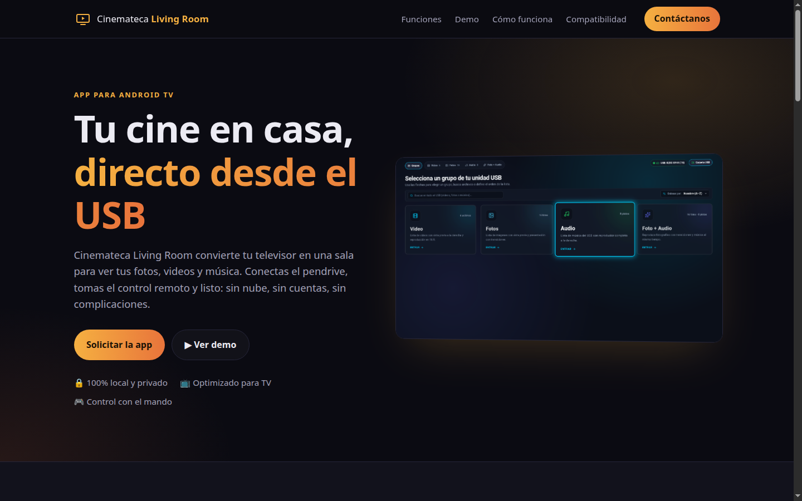
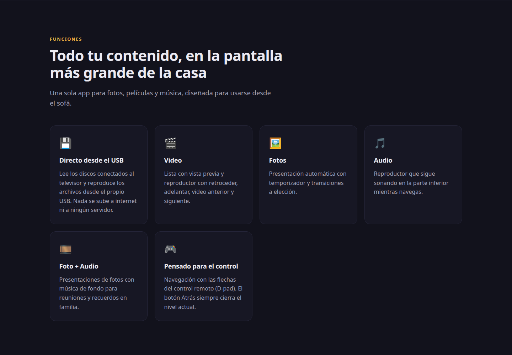
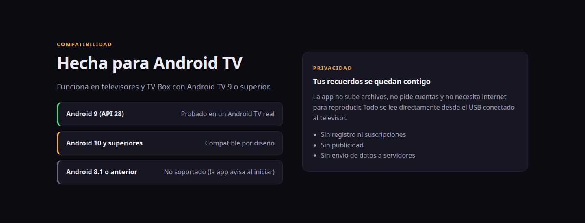
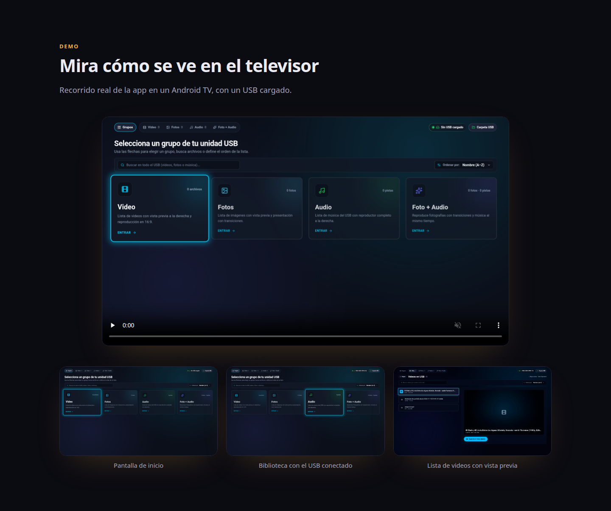
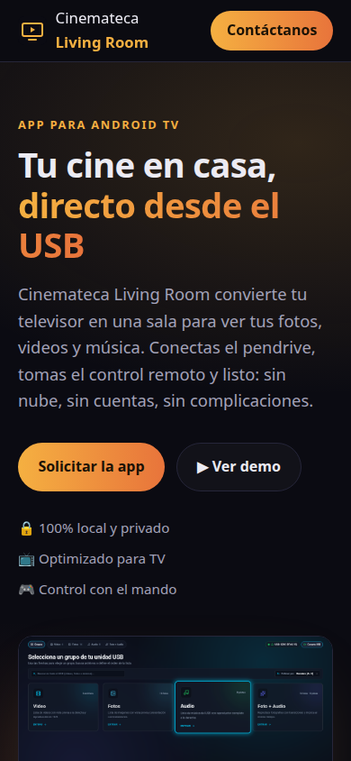

# Cinemateca Living Room — Landing page

[](https://github.com/jsanhuezamolina-ai/web_cinemateca_living_room/actions/workflows/build.yml)

Sitio de una página, hecho con [Astro](https://astro.build), que presenta **Cinemateca Living Room**:
una app para Android TV que reproduce fotos, videos y música desde un USB y se controla con el
mando del televisor.

La app tiene su propio repositorio:
[jsanhuezamolina-ai/cinemateca-living-room](https://github.com/jsanhuezamolina-ai/cinemateca-living-room).



## Vista previa

| Funciones | Compatibilidad y privacidad |
|---|---|
|  |  |

| Demo en video y capturas | Móvil |
|---|---|
|  |  |

## Secciones

| Sección | Contenido |
|---|---|
| Hero | Propuesta de valor, captura de la app y botones de contacto y demo |
| Funciones | USB, video, fotos, audio, foto + audio y control con el mando |
| Demo | Video de la app en un Android TV y tres capturas |
| Cómo funciona | Tres pasos: instalar, conectar el USB y ver |
| Compatibilidad | Versiones de Android TV soportadas y privacidad |
| Contacto | Botón de contacto por correo |

## Tecnología

- **Astro 5**, con salida estática y sin JavaScript en el cliente.
- **CSS propio**, sin frameworks. Las variables de diseño están en `src/styles/global.css`.
- **Diseño adaptable:** escritorio, tablet y móvil. Respeta `prefers-reduced-motion`.
- **Optimización:** las imágenes tienen dimensiones fijas para evitar saltos de diseño, las capturas se cargan al hacer scroll (*lazy loading*) y el video solo se descarga al reproducirlo.

## Requisitos

- Node.js 22 (ver `.nvmrc`). Se usa Astro 5 porque Astro 6 pide Node 22.23.4 o superior.

## Uso

```bash
npm install
npm run dev       # desarrollo en http://localhost:4321
npm run check     # chequeo de tipos y plantillas
npm run build     # sitio estático en dist/
npm run preview   # sirve dist/ para revisarlo
```

## Estructura

```
src/
  pages/index.astro       La página y sus estilos de sección
  layouts/Base.astro      <head>, título, descripción y favicon
  styles/global.css       Colores, tipografía, botones, tarjetas y grillas
public/
  favicon.svg
  media/                  Capturas de la landing y de la app, y el video demo
.github/workflows/        CI: instala, revisa y compila en cada push y pull request
```

## Despliegue

`npm run build` genera `dist/`, que es HTML, CSS y archivos estáticos. Se puede publicar en
cualquier hosting estático, como Netlify, Vercel, Cloudflare Pages o GitHub Pages, o servir con
Nginx.

## Personalización

- **Correo de contacto:** constante `CONTACT` en `src/pages/index.astro`. **El valor actual es de ejemplo.**
- **Textos de funciones, pasos y compatibilidad:** los arreglos `features`, `steps` y `compat`, en el mismo archivo.
- **Colores:** variables `--accent`, `--bg` y otras en `src/styles/global.css`.

## Licencia

Pendiente de definir por el autor.
